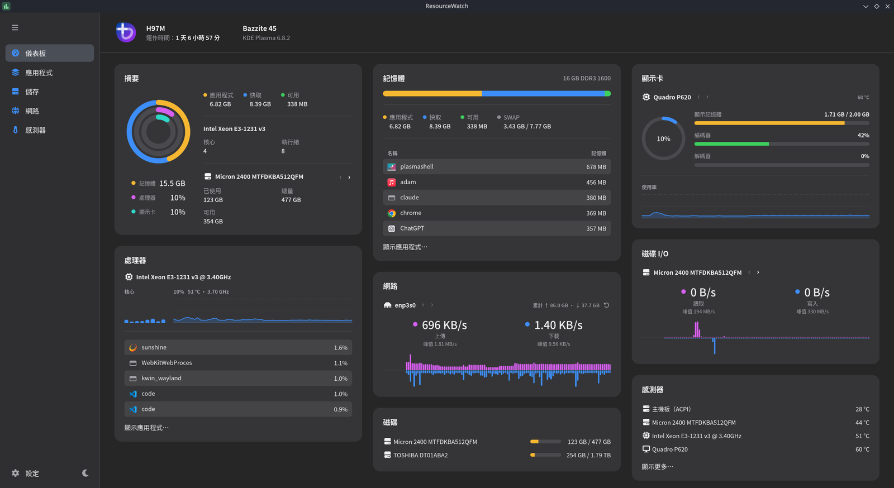
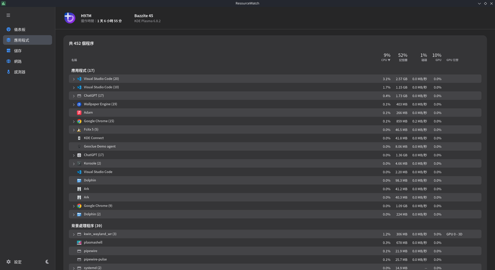
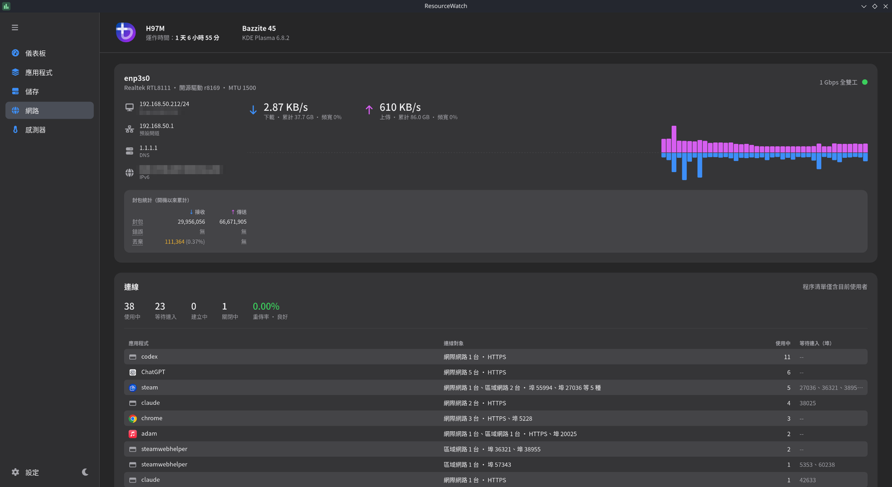
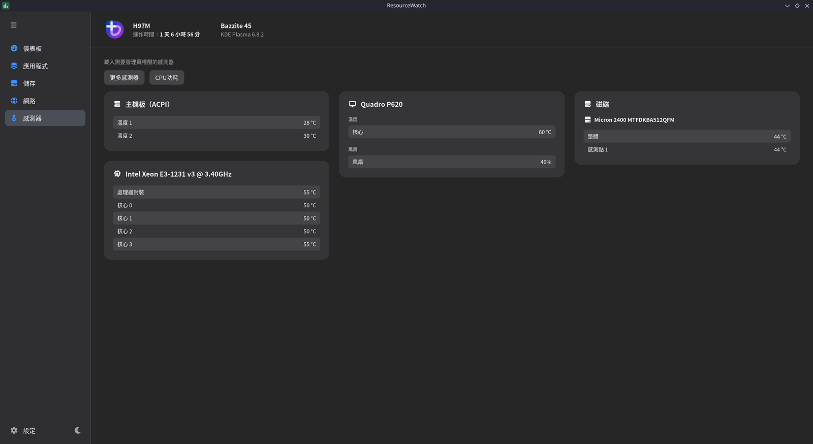
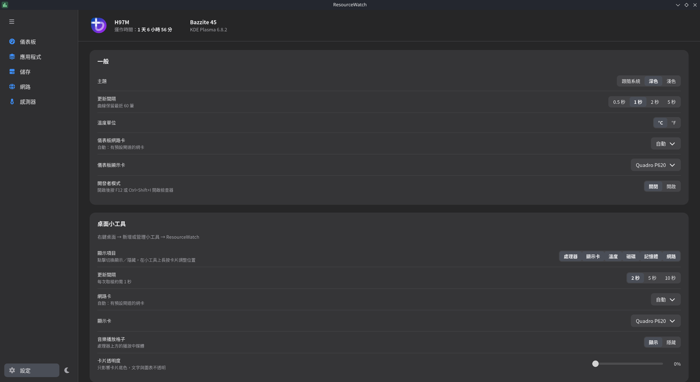
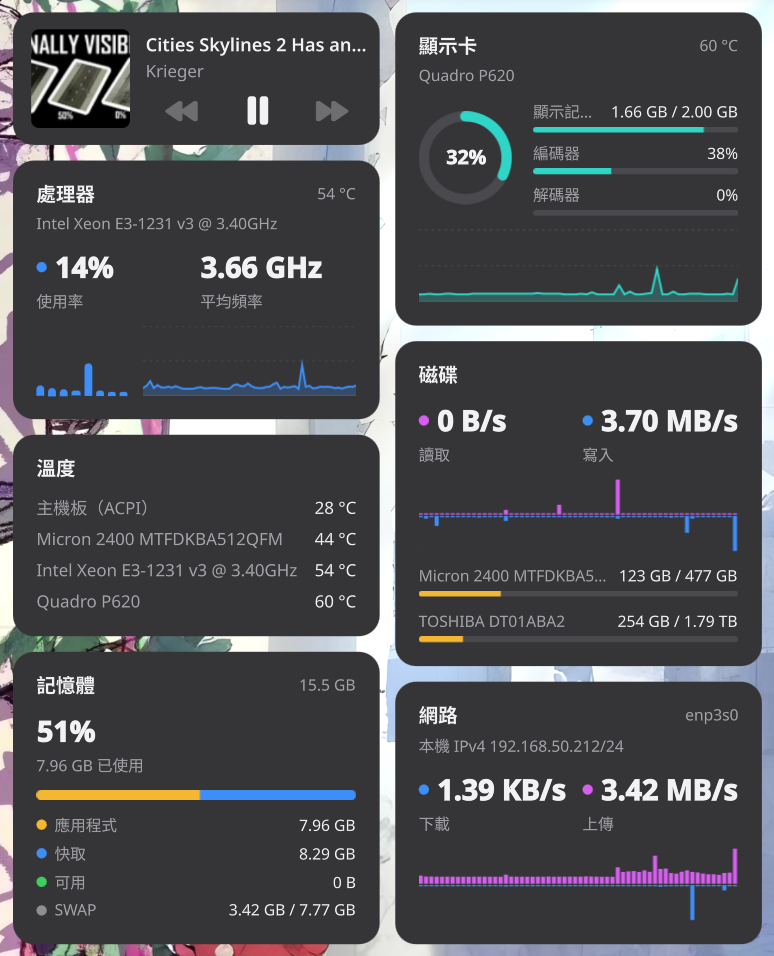
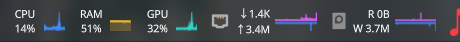
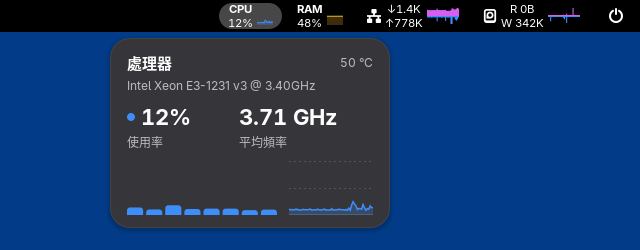

# ResourceWatch

**Linux 系統資源監控** · Rust + Tauri 2 · KDE Plasma 6 桌面／面板小工具 · GNOME 頂欄 · MIT License

## 1. 簡介

ResourceWatch 是儀表板式的 Linux 系統監控程式，即時顯示 CPU、記憶體、顯示卡、磁碟、網路、感測器與程序，並內建資料夾空間分析。
同一個執行檔也提供小工具的資料：KDE Plasma 6 可以放在桌面或面板上，GNOME 則顯示在頂欄，都不必開著主程式。



- 不連網路、沒有常駐背景服務，只讀 `/proc` 與 `/sys`。
- 讀不到的數值顯示 `--`，不會當成 0。
- 安裝在使用者目錄，不需要 sudo，適用 Bazzite 等不可變系統。
- 顯示卡支援 NVIDIA（執行期載入 NVML，沒有驅動也能啟動）、AMD 與 Intel。

## 2. 安裝需求

### 執行

| 項目 | 需求 |
| --- | --- |
| 作業系統 | Linux（x86_64） |
| App | WebKitGTK 4.1（大多數桌面發行版已內建） |
| 桌面／面板小工具 | **KDE Plasma 6.0 以上**（需要 `kpackagetool6`） |
| 頂欄擴充功能 | **GNOME 46 以上**（需要 `gnome-extensions`）；其他桌面環境只能使用 App |
| 音樂播放格子（Plasma） | 支援 MPRIS 的播放器（大多數音樂 App、瀏覽器都支援） |
| 感測器頁的「載入更多感測器」 | polkit（`pkexec`），按下按鈕時才會要求授權 |
| NVIDIA 顯示卡資料 | NVIDIA 專有驅動（提供 `libnvidia-ml.so.1`）；沒有時只是不顯示 NVIDIA 資料 |
| Wi-Fi 詳細資訊 | `iw`（沒有時只是不顯示訊號與頻段） |

### 建置

目前沒有預先編譯的版本，安裝時會從原始碼建置，需要：

- Rust stable 與 tauri-cli 2（`cargo install tauri-cli --version "^2"`）
- WebKitGTK 4.1 等開發套件，各發行版的套件名稱見 [Tauri 的系統需求](https://v2.tauri.app/start/prerequisites/#linux)

不可變系統（例如 Bazzite）可以在 distrobox 容器裡建置，安裝腳本會自動使用名為 `resourcewatch-dev` 的容器：

```bash
distrobox create -n resourcewatch-dev -i fedora:latest
distrobox enter resourcewatch-dev -- bash -lc '
  sudo dnf install -y @c-development webkit2gtk4.1-devel openssl-devel curl wget file libappindicator-gtk3-devel librsvg2-devel rust cargo &&
  cargo install tauri-cli --version "^2"'
```

## 3. 安裝方式

```bash
git clone https://github.com/je991707-star/ResourceWatch.git
cd ResourceWatch
./install.sh
```

`install.sh` 會建置 release 版，並安裝到使用者目錄：

| 檔案 | 位置 |
| --- | --- |
| 執行檔 | `~/.local/bin/resourcewatch` |
| 應用程式選單啟動器與圖示 | `~/.local/share/applications/`、`~/.local/share/icons/` |
| Plasma 小工具（有 KDE Plasma 6 時） | `~/.local/share/plasma/plasmoids/` |
| GNOME 頂欄擴充功能（有 GNOME 時） | `~/.local/share/gnome-shell/extensions/` |

- 有 distrobox 容器 `resourcewatch-dev` 時在容器內建置（可用環境變數 `RESOURCEWATCH_BOX` 指定其他容器），否則用主機的 `cargo tauri`。
- 更新：拉取新版後再執行一次 `./install.sh`。更新小工具後 Plasma 會沿用快取的舊版，需重新登入或執行：

  ```bash
  systemctl --user restart plasma-plasmashell
  ```

- GNOME：新安裝或更新擴充功能後需重新登入（Wayland 無法即時載入擴充功能），之後可在「擴充功能」App 開關。

- 解除安裝（同時刪除小工具設定 `~/.config/resourcewatch`）：

  ```bash
  ./install.sh uninstall
  ```

## 4. 功能介紹

### App

| 頁面 | 內容 |
| --- | --- |
| 儀表板 | 記憶體／CPU／顯示卡摘要環形圖、各執行緒使用率、網路與磁碟 I/O 曲線、磁碟用量、顯示卡（含編碼器／解碼器）、感測器摘要，以及 CPU／記憶體前 5 名程序 |
| 應用程式 | 依應用程式／背景／系統分區，同一應用的程序合併成一組並可展開；欄位有 CPU、記憶體、磁碟、GPU 與 GPU 引擎，點標題排序 |
| 儲存 | 資料夾空間分析：逐層色塊圖與檔案清單；可選磁碟或任意資料夾，掃描中即時顯示進度、可取消 |
| 網路 | 每張網卡的位址、閘道、DNS、連線速度、Wi-Fi 訊號與頻段、封包錯誤統計；「連線」卡列出 TCP 狀態、重傳率與各程序的連線對象 |
| 感測器 | 溫度、風扇、電壓、功耗，依裝置分卡、名稱翻成中文；可一鍵載入額外的感測器模組或開放 CPU 功耗讀取（經 polkit 授權，效果到重開機為止） |
| 設定 | 主題、更新間隔、溫度單位、儀表板預設網路卡／顯示卡、開發者模式，以及桌面／面板小工具的所有設定 |









### 桌面小工具

右鍵桌面 → 新增或管理小工具 → **ResourceWatch**。



- **卡片**：處理器、記憶體、顯示卡、網路、磁碟、溫度，兩欄排列；在 App 的設定頁切換要顯示哪些卡片。
- **調整位置**：在卡片內容上長按後拖曳。按住標題列或卡片之間的空白，則是移動整個小工具。右鍵選單可以關閉滑鼠下的那張卡片。
- **音樂播放格子**：顯示目前播放的媒體，包括專輯圖、曲名、進度，以及上一首／播放暫停／下一首按鈕。它填滿處理器那一欄多出的空間，依高度自動切換顯示方式：

  | 可用高度 | 顯示 |
  | --- | --- |
  | 小於 60 px | 隱藏 |
  | 60–100 px | 專輯圖與按鈕 |
  | 100 px 到約 139 px | 再加上曲名與演出者 |
  | 約 139 px 以上 | 再加上時間與進度條 |

- **其他設定**：更新間隔（2／5／10 秒）、網路卡與顯示卡、卡片底色透明度。

### 面板小工具

把同一個小工具拖進面板，每個項目會顯示數值與迷你圖；點一下彈出該項的完整卡片。



面板的顯示項目、順序、網路卡與顯示卡都和桌面版分開設定；項目順序在設定頁拖動按鈕調整。

### GNOME 頂欄

GNOME 沒有桌面小工具，改以頂欄擴充功能提供和面板小工具相同的項目；點一下彈出該項的卡片，卡片跟隨 GNOME 的淺色／深色樣式。



顯示項目、順序、網路卡、顯示卡與更新間隔在 App 設定頁的「頂欄」卡片設定（在 GNOME 下，設定頁只會顯示這張卡片）。

## 5. 開發

```bash
cd src-tauri
cargo tauri dev                    # 開發執行
cargo tauri build --no-bundle      # release 執行檔 → ../target/release/resourcewatch
cargo fmt --check && cargo clippy --all-targets -- -D warnings && cargo test
```

- 前端在 `frontend/`，是不需打包工具的純 HTML／CSS／JS；Plasma 小工具在 `widget/`（純 QML），GNOME 擴充功能在 `gnome/`（GJS），都沒有編譯步驟。
- GNOME 擴充功能可在 distrobox 容器裡以隔離的無頭 GNOME Shell 測試，見 `gnome/dev/nested.sh`。
- 小工具的資料來自 `resourcewatch --widget`：輸出一次 JSON（設定與快照），不會開視窗。
- 在沒有整合 NVIDIA 驅動的容器內執行時讀不到 NVIDIA 顯示卡，請在主機上執行。

文件：

- [Readme_Architecture.md](docs/Readme_Architecture.md)：各檔案的職責、資料流、指令介面與 JSON 格式
- [Sensors_Improvement.md](docs/Sensors_Improvement.md)：讓額外感測器在開機時自動載入的手動設定

## 6. 授權

MIT License。圖示使用 Font Awesome Free 7.3.1（圖示 CC BY 4.0、字型 SIL OFL 1.1、程式 MIT），App 與小工具各附一份授權檔。
